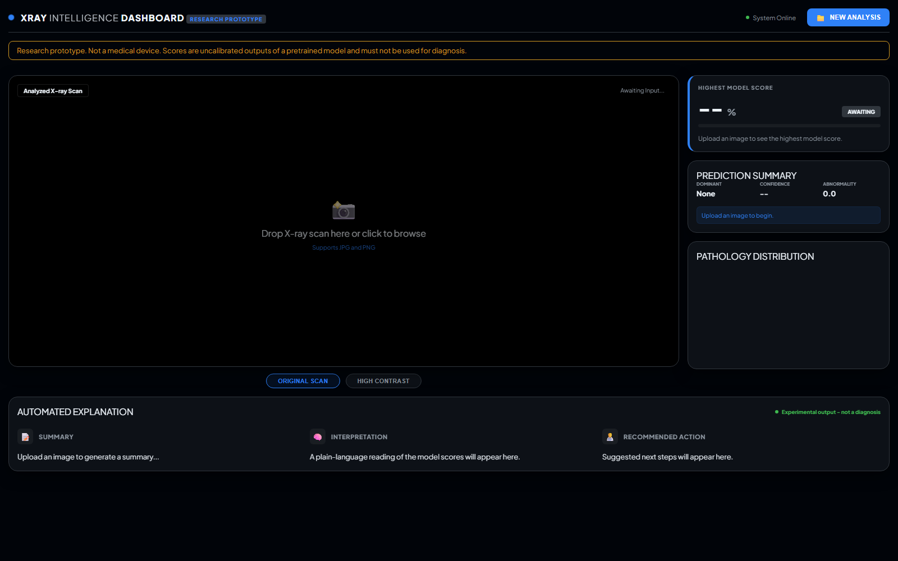
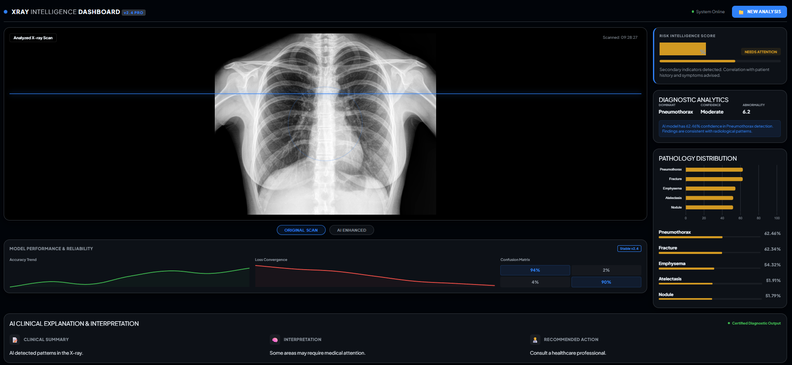

# Chest X-ray Analysis (research prototype)

[](https://github.com/projectbin07-stack/xray-analysis-aiml/actions/workflows/ci.yml)
[](LICENSE)

A FastAPI dashboard around the pretrained
[TorchXRayVision](https://github.com/mlmed/torchxrayvision) DenseNet121
chest X-ray classifier. It shows the model's per-pathology scores, bands them
for display, and can ask a local LLM (Ollama) to rephrase the scores in plain
language.

> **Not a medical device.** This is experimental research and learning
> software. The model was not trained or validated by this project, its scores
> are uncalibrated, and nothing here may be used for diagnosis or treatment
> decisions.



## What this project is (and is not)

- It **is** an application layer: upload handling, inference wrapper, score
  banding, an optional LLM explanation step, a web dashboard and a CLI.
- It is **not** a new model. Classification is done entirely by the
  TorchXRayVision weights `densenet121-res224-all`, used unchanged. No training,
  fine-tuning or evaluation was performed in this repository, so no accuracy
  figures are reported here. See the TorchXRayVision paper and repository for
  the model's own evaluation.

## Features

- Multi-label pathology scores for a chest X-ray (top 5 shown)
- Display banding per score: LOW (≤ 40%), MODERATE (40-70%), HIGH (> 70%), and
  an overall status from the highest score. These cut-offs are presentation
  choices, not clinically derived thresholds.
- Optional plain-language explanation from a local Ollama model, with fixed
  non-diagnostic wording when Ollama is not running
- Web dashboard (vanilla JS + Chart.js) and a command-line tool
- Uploads are validated, analysed and deleted; nothing is stored or served back

## Quick start

Requires Python 3.10+. The first run downloads the model weights
(TorchXRayVision caches them in your user directory).

```bash
git clone https://github.com/projectbin07-stack/xray-analysis-aiml.git
cd xray-analysis-aiml
python -m venv .venv
# Windows: .venv\Scripts\activate    Linux/macOS: source .venv/bin/activate
pip install -r requirements.txt
python app.py
```

Open `http://127.0.0.1:8001` and upload a JPG or PNG chest X-ray. The server
binds to localhost only; set `HOST=0.0.0.0` to expose it on your network.

Command line, without the web server:

```bash
python -m core.xray_engine --image path/to/xray.png --top-k 5
```

### Optional: LLM explanation

Install [Ollama](https://ollama.com), run `ollama pull llama3`, and keep it
running. Without it the dashboard still works and shows a fixed explanation.

### Configuration

| Variable | Default | Purpose |
|---|---|---|
| `HOST` | `127.0.0.1` | Bind address |
| `PORT` | `8001` | Port |
| `OLLAMA_URL` | `http://localhost:11434/api/generate` | Local LLM endpoint |
| `OLLAMA_MODEL` | `llama3` | Model used for the explanation |
| `OLLAMA_TIMEOUT_S` | `15` | Timeout before the fixed explanation is used |
| `LOG_LEVEL` | `INFO` | Python logging level |

## API

`POST /analyze` with multipart field `image` (jpg, png or bmp, up to 15 MB).
The numbers below only illustrate the response shape.

```json
{
  "predictions": [{"disease": "Effusion", "confidence": 82.0, "risk": "HIGH"}],
  "status": "CRITICAL",
  "explanation": {"summary": "...", "meaning": "...", "recommendation": "..."},
  "confidence_scores": [82.0],
  "labels": ["Effusion"]
}
```

Errors are returned as `{"error": "..."}` with a 4xx/5xx status.
`GET /health` returns `{"status": "ok", "model_loaded": true|false}`.

## How it works

```
upload ──> validate (type, size) ──> temp file ──> XRayInferenceEngine
                                                      │  grayscale, normalise,
                                                      │  centre-crop, 224x224
                                                      ▼
                                              DenseNet121 (TorchXRayVision)
                                                      │  sigmoid scores
                                                      ▼
                              core/report.py: banding + status ──> JSON ──> dashboard
                                                      │
                                                      └─> optional Ollama rephrasing
```

| Path | Role |
|---|---|
| `app.py` | FastAPI routes, upload validation, Ollama call |
| `core/xray_engine.py` | Model loading, preprocessing, inference, CLI |
| `core/report.py` | Score banding and LLM-output parsing (no PyTorch dependency) |
| `static/`, `templates/` | Dashboard |
| `tests/` | pytest suite |

## Development

```bash
pip install -r requirements-dev.txt
ruff check . && ruff format --check .
pytest
```

CI runs these on Python 3.10 and 3.13. Tests cover score banding, LLM-output
parsing, upload validation, upload deletion and error handling, with the model
replaced by a fake. CI does **not** install PyTorch or run the real network, so
`core/xray_engine.py` is verified only by manual runs.

## Known limitations

- Scores are raw sigmoid outputs of a pretrained multi-dataset model; they are
  not calibrated probabilities and the display bands are arbitrary.
- No check that the uploaded image is actually a frontal chest X-ray; any image
  produces scores.
- DICOM is not supported (JPG/PNG/BMP only) and images are centre-cropped to a
  square, which can cut off anatomy.
- No localisation or saliency maps: the "high contrast" toggle is a display
  filter, not model output.
- LLM explanations can be wrong or overconfident; the prompt forbids diagnosis
  but output is not otherwise checked.

## Roadmap

- Grad-CAM overlays for the top predictions
- CI job that runs the real model on a public sample image
- Input sanity check (reject non-X-ray images)
- DICOM input

## Screenshots

| | |
|---|---|
|  |  |

The screenshots were taken with an earlier version of the interface; a panel
they show with illustrative "model performance" figures has since been removed
because those numbers were not measurements.

## License

MIT for the code in this repository - see [LICENSE](LICENSE). TorchXRayVision
and its model weights are distributed under their own terms (Apache-2.0 for the
library; check the upstream repository for dataset-related conditions).

See [CONTRIBUTING.md](CONTRIBUTING.md) and [SECURITY.md](SECURITY.md). Never
post identifiable patient images in issues or pull requests.

## Author

Navaneeth KG
